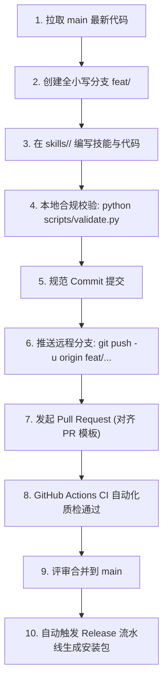

# Open Agent Skills 贡献与协作规范 (Contributing Guide)

感谢关注并参与 **Open Agent Skills** 智能体公开技能库！为了确保全平台开发者与各类型 AI Agent（Antigravity、Claude Code、Cursor、Codex 等）能够安全、高效、无冲突地协同共建，本仓库制定了严格的代码管理与同步规范。

---

## ⚡ 核心协作铁律 (Core Principles)

参与本仓库的所有开发者与 AI Agent，必须严格遵守以下协作铁律：

1. **主分支受保护 (Protected `main`)**：
   - 严禁直接在 `main` / `master` 分支上进行开发与 commit。
   - 严禁向远程 `origin/main` 直接执行 push 操作。
   - 唯一合法的合入路径：在**全小写特性分支**上开发 -> 推送到远程特性分支 -> 发起 Pull Request (PR) -> 经 CI 校验与审查后合入。
2. **分支命名铁律：必须且只能全小写**：
   - Windows 与 macOS 文件系统对大小写不敏感，而 GitHub Linux 服务器严格区分大小写。若分支名混用大写字母，极易在团队拉取时引发致命引用混乱。
   - 合法示例：`feat/sql-optimizer`、`fix/path-resolver`、`docs/update-readme`。
   - 违规示例：`feat/SQLOptimizer`、`Fix/Bug`（将被本地 Git Hook 直接拦截）。
3. **Commit 规范与简体中文**：
   - 遵循 [Conventional Commits](https://www.conventionalcommits.org/) 规范，格式为 `<type>(<scope>): <简明中文说明>` 或 `<type>: <简明中文说明>`。
   - 合法 type 包括：`feat`、`fix`、`skill`、`docs`、`ci`、`infra`、`refactor`、`test`、`chore`。
4. **单文件体积限制 (≤ 15MB)**：
   - 为避免 Git 历史库膨胀，禁止提交单文件大于 15MB 的大文件或二进制产物。
   - 安装包由 GitHub Actions 自动化构建并挂载于 [GitHub Releases](https://github.com/nanszyt/open-agent-skills/releases)。
5. **Markdown 实体先行 (Markdown-First)**：
   - 涉及多行详细说明的 Commit、PR 正文或 Issue 描述，统一先在本地 `.drafts/` 目录下落盘为 `.md` 实体文件（如 `.drafts/pr-body.md`），再通过参数传参（如 `git commit -F` 或 `gh pr create --body-file`），杜绝命令行多行拼接导致的引号转义与乱码问题。

---

## 🛠️ 本地环境与 Git Hooks 一键激活

首次克隆仓库后，**必须第一时间激活 Git Hooks** 以启用本地安全守卫：

### Windows 用户 (PowerShell)
```powershell
.\.githooks\setup.ps1
```

### macOS / Linux / Git Bash 用户
```bash
bash .githooks/setup.sh
```

> **已激活的守卫策略**：
> - `pre-commit`：拦截 `main` 分支直提、大写分支名、>15MB 大文件以及 Windows 非法字符与保留设备名；
> - `commit-msg`：强制校验 Conventional Commits 与中文描述；
> - `pre-push`：拦截直接推送到远程 `main` 分支的操作。

---

## 🔄 标准贡献全流程 (Step-by-Step Workflow)



### 步骤 1：同步并创建全小写特性分支
```bash
git checkout main
git pull origin main
git checkout -b feat/my-awesome-skill
```

### 步骤 2：技能开发与放置
在 `skills/` 目录下创建以该技能标识命名的文件夹：
```
skills/my-awesome-skill/
├── SKILL.md                 # 必选：技能核心描述与指令（含 YAML frontmatter）
├── scripts/                 # 可选：配套 Python 脚本或工具
└── resources/               # 可选：模板文件、数据样例或静态资产
```

`SKILL.md` 头部必须包含准确的 YAML frontmatter，且 `name` 必须与文件夹名称完全一致：
```yaml
---
name: my-awesome-skill
description: 用一到两句话清晰说明该技能的核心能力、适用场景与触发词。
---
```

### 步骤 3：本地合规性自检
发起提交前，必须运行本地校验工具：
```bash
python scripts/validate.py
```
若有格式、命名或文件体积问题，校验工具将逐项提示修复。

### 步骤 4：规范 Commit 提交
```bash
# 单行提交
git commit -m "feat(skill): 添加 my-awesome-skill 核心提示词与配套脚本"

# 或多行详细提交 (Markdown 实体先行)
# 1. 编写 .drafts/commit-msg.md
# 2. 执行：
git commit -F .drafts/commit-msg.md
```

### 步骤 5：推送远程分支
```bash
git push -u origin feat/my-awesome-skill
```

### 步骤 6：创建 Pull Request
使用 GitHub 网页或 GitHub CLI (`gh`) 创建 PR：
```bash
# 在 .drafts/pr-body.md 中按 .github/pull_request_template.md 填好说明
gh pr create --title "feat(skill): 添加 my-awesome-skill 技能" --body-file .drafts/pr-body.md
```

### 步骤 7：CI 质检与自动化发布
- 提交 PR 后，GitHub Actions 会自动执行 `CI` 流水线，校验目录结构与规范；
- 审核合入 `main` 分支后，`release.yml` 流水线会自动打包并向 [GitHub Releases](https://github.com/nanszyt/open-agent-skills/releases) 发布新的绿色免配置安装包（含 `install.bat` 与 `install.sh`）。

---

## 🪟 Windows 跨平台协作注意事项

- **换行符统一**：项目已配置 `.gitattributes`，Hooks 和脚本强制使用 `LF`，Windows 批处理保持 `CRLF`。请确保本地执行了 `git config core.autocrlf false`。
- **非法字符**：文件名中严禁使用 Windows 非法字符（`: * ? " < > |`）和保留名（`CON`, `PRN`, `AUX`, `NUL`, `COM1-9`, `LPT1-9`）。
- **终端输出规范**：为避免 Windows 终端代码页乱码，脚本终端交互输出请统一使用 ASCII 英文，代码注释与文档使用简体中文。
