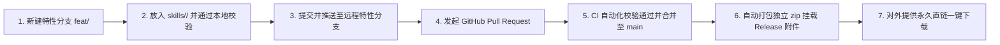

# Open Agent Skills (智能体公开技能库)

> 本仓库是一个**公开开源的 AI Agent 技能集合与分发中心**。参考 [Anthropic Agent Skills Standard](https://github.com/anthropics/skills) 标准构建，支持 Google Antigravity、Claude Code、Cursor、Codex 等主流智能体平台。
>
> 🚀 **自动发布机制**：仓库已配置 GitHub Actions 自动化工作流。**只要向 `skills/` 目录新增或更新技能并推送到 `main` 分支，CI 会自动将每个技能打包为独立的绿色免配置安装包（内附 Windows `install.bat` 与 macOS/Linux `install.sh`），并作为 GitHub Release 附件供任何人免登录一键下载使用！**

---

## 📦 公开技能索引与一键下载 (Skills Catalog & Direct Downloads)

| 技能标识 (ID) | 核心功能简介 | 独立一键安装包 (Release 附件) | 源代码入口 |
|---|---|---|---|
| **`hose-ppt`** | 基于合思官方标准母版的 16:9 演示文稿自动化制作（微软雅黑统一规范、四层卡片自适应间距、内置 30+ 矢量图标服务、自动排版质检） | [⬇️ 下载 `hose-ppt.zip`](https://github.com/nanszyt/open-agent-skills/releases/download/latest/hose-ppt.zip) | [`SKILL.md`](./skills/hose-ppt/SKILL.md) |

*(随着你向本仓库持续同步技能，GitHub Actions 会自动更新并挂载更多技能的独立下载包)*

---

## 🛠️ 安装与使用方式 (Installation & Usage)

### 方式 1：直接下载 Release 附件安装（最推荐 · 小白友好）
1. 在上方表格或 [Releases 页面](https://github.com/nanszyt/open-agent-skills/releases/latest) 点击下载对应技能的 `.zip` 文件；
2. 解压下载的压缩包：
   - **Windows**：直接双击运行 **`install.bat`**；
   - **macOS / Linux**：终端执行 **`bash install.sh`**；
3. 打开 Antigravity 或任何支持 Agent Skills 的终端，即可直接唤醒使用对应技能。

### 方式 2：使用仓库自带的同步工具 (Developer CLI)
在克隆本仓库后，可通过 [`scripts/sync.py`](./scripts/sync.py) 一键将所有技能安装到本机全局：
```bash
git clone https://github.com/nanszyt/open-agent-skills.git
cd open-agent-skills

# 一键安装所有公开技能到本机
python scripts/sync.py --install-all

# 或仅安装单个技能
python scripts/sync.py --install hose-ppt
```

### 方式 3：团队项目代码库挂载 (Workspace Mounting)
在团队的项目代码库根目录中，直接通过 Git Subtree 或克隆到 `.agents/skills/` 目录下，团队成员拉取代码后自动免安装生效：
```bash
python scripts/sync.py --install hose-ppt --workspace "C:\path\to\your-team-project"
```

---

## 🔄 如何向本仓库发布与同步新技能？(Branch & PR Workflow)

> ⚠️ **协作铁律**：本仓库遵循严格的 Git 同步规范，**严禁直接在 `main` 主分支提交或直推**。所有改动必须通过全小写特性分支发起 Pull Request (PR)，经 CI 自动化质检通过后合入。详情参见 👉 [**CONTRIBUTING.md**](./CONTRIBUTING.md)。

本仓库配备了全自动打包发布流水线：



### 标准操作步骤：
1. **本地环境守卫一键初始化**（首次拉取仓库只需执行一次）：
   ```powershell
   # Windows PowerShell:
   .\.githooks\setup.ps1

   # macOS / Linux / Git Bash:
   bash .githooks/setup.sh
   ```
2. **切出全小写特性分支**：
   ```bash
   git checkout main
   git pull origin main
   git checkout -b feat/my-skill
   ```
3. **添加技能并进行合规性自检**：
   ```bash
   # 复制技能到 skills/ 目录后执行校验
   python scripts/validate.py
   ```
4. **规范提交并推送到远程特性分支**：
   ```bash
   git add skills/my-skill
   git commit -m "feat(skill): 添加 my-skill 技能"
   git push -u origin feat/my-skill
   ```
5. **创建 Pull Request 合入 `main`**：
   ```bash
   gh pr create --title "feat(skill): 添加 my-skill 技能" --body "详见变更说明"
   ```
6. **自动化发布**：PR 经审查合入 `main` 后，GitHub Actions 会在 1 分钟内自动打包并更新 [Latest Release](https://github.com/nanszyt/open-agent-skills/releases/latest) 中的独立下载包附件！

---

## 规范与标准

* 贡献与 Git 分支 PR 规范请参考：👉 [**CONTRIBUTING.md**](./CONTRIBUTING.md)
* Agent 协作守则请参考：👉 [**AGENTS.md**](./AGENTS.md)
* 技能编写规范请参考：👉 [Agent Skills Specification](./spec/agent-skills-spec.md)
* 脚手架模板请参考：👉 [`template/`](./template/)
